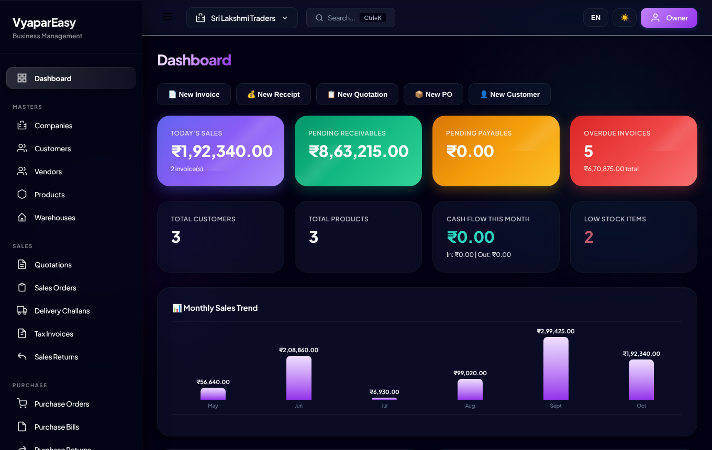
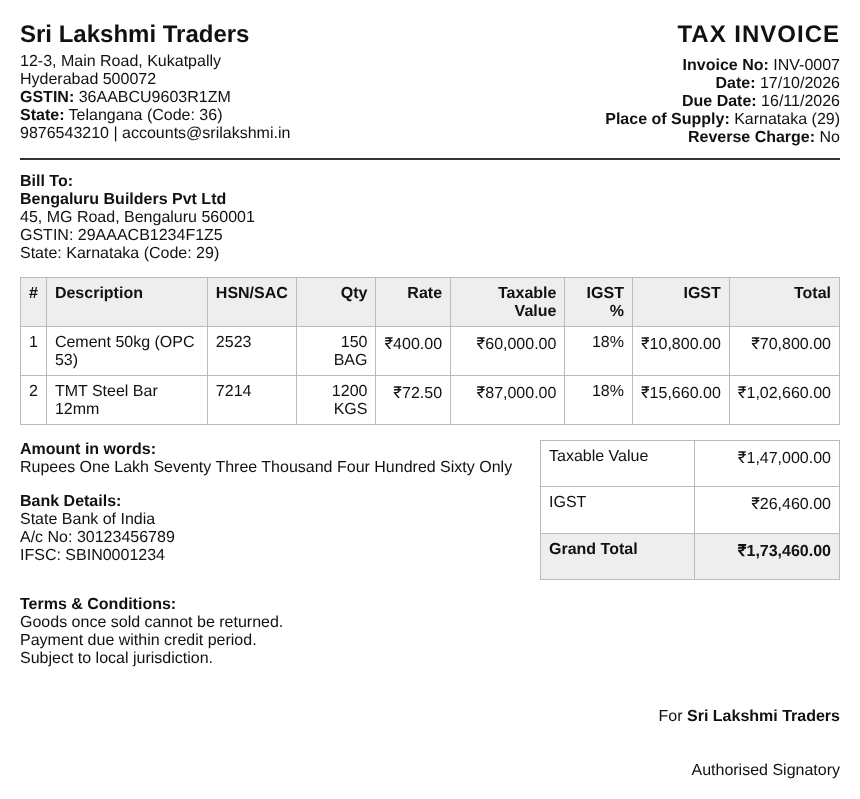

# VyaparEasy

**Free, open-source GST billing, inventory and accounts for Indian small businesses. Works offline, with your data kept on your own device.**

[](https://github.com/yeldhandisamyukthreddy-del/indian-b2b-business-manager/actions/workflows/ci.yml)
[](LICENSE)



## Features

- **GST tax invoices** with automatic CGST + SGST (same state) or IGST (other state), HSN/SAC codes, place of supply, amount in words and round-off. Print or save as PDF.
- **Sales flow:** quotation → sales order → delivery challan → tax invoice, plus credit notes (sales returns)
- **Purchases:** purchase orders, purchase bills (with or without a PO) and debit notes (purchase returns)
- **Receipts and payments** linked to invoices and bills, so you see *Paid / Partial / Overdue* at a glance. Bank balances update automatically.
- **Inventory:** stock moves with every sale, purchase and return; low-stock alerts per product
- **GST reports:** GSTR-1 summary (B2B / B2CL / B2CS, credit notes, HSN summary) and GSTR-3B summary, with CSV export
- **Reports:** sales, purchases, outstanding, day book, item-wise, party-wise, simple profit & loss; customer and vendor ledgers
- **Multiple companies** (each GSTIN has its own invoice series)
- Employees and payslips, vehicles and fuel expenses
- WhatsApp sharing, Ctrl+K search, keyboard shortcuts, dark/light theme, English and Telugu menus
- **Offline and private:** no account, no server, no internet needed after install



## Install

Pick whichever suits you. Both give you the same app.

### Option 1: Web app (no download; works on Windows, Mac, Linux, Android, ChromeOS)

1. Open **https://yeldhandisamyukthreddy-del.github.io/indian-b2b-business-manager/** in Chrome or Edge.
2. Click the **Install** icon in the address bar (on Android: menu ⋮ → *Add to Home screen* / *Install app*).
3. It now opens like a normal app and works without internet. Updates arrive automatically when you're online.

### Option 2: Desktop app

Download the installer for your computer from the [Releases page](https://github.com/yeldhandisamyukthreddy-del/indian-b2b-business-manager/releases/latest):

| System | File |
| --- | --- |
| Windows | `VyaparEasy-Setup-x.y.z.exe` |
| macOS (Apple Silicon / Intel) | `VyaparEasy-x.y.z-arm64.dmg` / `VyaparEasy-x.y.z-x64.dmg` |
| Linux | `VyaparEasy-x.y.z-x86_64.AppImage` or `.deb` |

The installers are not code-signed yet (signing certificates cost money), so your computer will warn you the first time:

- **Windows:** "Windows protected your PC" → click **More info** → **Run anyway**.
- **macOS:** right-click the app → **Open** → **Open**. If macOS says the app is damaged, run `xattr -cr /Applications/VyaparEasy.app` in Terminal.
- **Linux AppImage:** make it executable (`chmod +x VyaparEasy-*.AppImage`) and run it.

## Your data and backups

- Everything is stored **only on your device**, inside the app (the browser's IndexedDB storage). Nothing is uploaded anywhere.
- The web app and the desktop app keep **separate** data. Use one of them, or move data between them with backup and restore.
- **Back up regularly:** *Settings → Backup All Data* downloads a `.json` file. Keep copies somewhere safe (Google Drive, a pen drive, email to yourself). The app reminds you if you haven't backed up for 7 days.
- Clearing your browser's site data, uninstalling the web app or losing the device **deletes your data** unless you have a backup.
- *Settings → Restore Data* replaces everything in the app with a backup file.

## Limitations (please read)

VyaparEasy is a practical billing and record-keeping tool, not a complete accounting package:

- It is **not double-entry accounting**: there is no chart of accounts, journal vouchers, trial balance or balance sheet. Profit & loss is simplified.
- **No direct GST portal integration:** no e-invoice (IRN/QR code) or e-way bill generation, and no upload-ready GSTR JSON. The GSTR-1/3B summaries and CSVs help you prepare returns; enter or upload them through the GST portal or offline tool.
- Not yet supported: reverse charge, composition scheme, cess, exports with LUT, TDS/TCS (the TDS page is a placeholder), and stock per warehouse.
- Payslips use a fixed simplified structure (Basic 50%, PF 12% of Basic, flat ₹200 professional tax). Check them against your state's rules.
- One user per device, no login, no multi-device sync.

**Disclaimer:** This software is provided as is, without warranty (see [LICENSE](LICENSE)). It is not tax or legal advice. GST rules change; verify invoices and returns with your accountant or CA before filing.

## For developers

The whole app is one file, [`app/index.html`](app/index.html) (plain HTML/CSS/JavaScript, no build step). [`electron/main.js`](electron/main.js) wraps it as a desktop app.

```bash
npm install                 # dev tools: Electron, electron-builder, Playwright
npm run serve               # web app at http://localhost:8080
npm start                   # desktop app
npx playwright install chromium
npm test                    # end-to-end tests (on Linux use: xvfb-run -a npm test)
npm run dist                # build installers for your OS into dist/
```

See [CONTRIBUTING.md](CONTRIBUTING.md) for how the code is organised and how to send changes.

### Publishing (maintainers)

- **Web app:** in GitHub, open *Settings → Pages* and set **Source** to **GitHub Actions** (one time). Every push to `main` then deploys `app/` to GitHub Pages.
- **Desktop installers:** bump `version` in `package.json`, commit, then `git tag v1.0.1 && git push origin v1.0.1`. The *Release desktop app* workflow builds Windows, macOS and Linux installers and attaches them to a GitHub Release.

## License

[MIT](LICENSE). Free to use, modify and share, including commercially. The bundled Plus Jakarta Sans font is under the [SIL Open Font License](app/fonts/OFL-PlusJakartaSans.txt).
